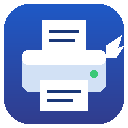

# Hermes – Folder Auto-Print



Small Windows tray app (Python 3.13 + PySide6). Point it at a folder, such as a Google Drive or OneDrive folder. Every *N* minutes it checks for matching documents, prints each one to the printer you chose, and moves it into a `Processed` subfolder.

Download HERE > https://github.com/vitaegd-spec/Hermes-Folder-Monitor/releases/

## Features
- Runs minimized in the **system tray**, with an optional **Start with Windows** setting (HKCU Run key, no admin needed).
- Check interval is adjustable (default **2 min**). The Status tab also has a **Check now** button.
- File types are editable (default `doc, docx, xls, xlsx, pdf`). Add `txt` to print text files.
- You pick the target printer from the printers already installed on the PC.
- Printed files are moved to **`Processed`** (name configurable). If a file with the same name is already there, the moved file gets a timestamp added to its name.
- Files that still fail after *X* attempts (default 3) are moved to **`Failed`**, so they don't retry forever.
- **Sync-safe:** a file is only printed after it has stayed unchanged for *N* seconds and isn't open or locked by Drive, OneDrive or Office.
- Never prints twice: if printing works but the move fails, Hermes only retries the move.
- Activity log in the UI, plus a rotating log file at `%APPDATA%\Hermes\hermes.log`.
- Tray notifications when files are printed or fail. Pause and Resume from the tray menu.

## How each type is printed
| Type | Method |
|---|---|
| PDF | Your default PDF app (e.g. Adobe Acrobat Reader) via the Windows "print to" command, sent to the selected printer |
| doc/docx/rtf/odt | Hidden Microsoft Word instance (macros disabled; your Windows default printer is left unchanged) |
| xls/xlsx/csv | Hidden Microsoft Excel instance (whole workbook) |
| txt/text/log | Notepad (`notepad.exe /pt "file" "printer"`), closes automatically after printing |
| Other | The default app's Windows "print to" command (`printto`) |

> Make sure Adobe Acrobat Reader (or another app that supports "print to") is the default PDF app. Edge does not support it.
> Password-protected Office files fail cleanly and end up in `Failed`, so no hidden dialog box blocks the app.

## Run from source
```
run.bat
```
(or `pip install -r requirements.txt` then `pythonw main.py`)

## Build EXE
```
build_exe.bat   →   dist\Hermes.exe
```

## First run
1. On the **Settings** tab, choose the watch folder and printer.
2. Change the interval or file types if needed, and tick **Start Hermes when Windows starts**.
3. Click **Save settings**.

Settings are stored in `%APPDATA%\Hermes\settings.json`.

## Notes
- Only the top level of the watch folder is checked. Subfolders (including Processed and Failed) are ignored.
- Office temp files (`~$…`) and hidden files are skipped.
- Only one copy of Hermes can run at a time.
- Printers that ask for a file name (e.g. *Microsoft Print to PDF*) show a Save dialog and are not suited for unattended printing.
